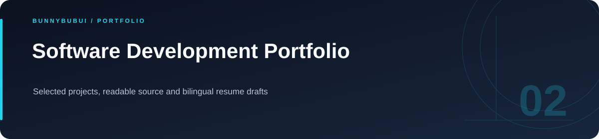

  

<h1 align="center">Software Development Portfolio</h1>

Selected projects, readable source and bilingual resume drafts

       

<a href="#overview">ภาพรวม</a> · <a href="#features">ความสามารถ</a> · <a href="#start">เริ่มใช้งาน</a> · <a href="#structure">โครงสร้าง</a> · <a href="#validation">ตรวจสอบงาน</a>

## ภาพรวม

ศูนย์รวมผลงานสำหรับสาย Full-stack / Software Developer รวม source ตัวอย่างที่แยกจากข้อมูลจริง พร้อมลิงก์ไปยังโปรเจกต์เด่นและร่างเรซูเม่สองภาษา

## เลือกชมผลงาน

| ผลงาน | ประเด็นที่แนะนำให้ดู | Source |
|---|---|---|
| Sports Results | MySQL transactions และ Socket.IO | [เปิดโปรเจกต์](portfolio/sports-results/) |
| Ticketing Platform | หน้าสั่งซื้อและโครงสร้าง backend | [เปิดโปรเจกต์](portfolio/ticketing-platform/) |
| Electricity Logger | Pagination และ MongoDB aggregation | [Repository](https://github.com/BunnyBubui/electricity-logger) |
| IoT Weather Monitor | MQTT → MongoDB → FastAPI | [Repository](https://github.com/BunnyBubui/Weather-lab-iot) |
| Order Management | Spring Boot/JPA และ order items | [Repository](https://github.com/BunnyBubui/prg-01-67100784) |
| Luma Camera | CameraX, WorkManager และ image processing | [Repository](https://github.com/BunnyBubui/LumaCamera) |

## เริ่มอ่านพอร์ต

1. เลือกงานจากตารางด้านบน แล้วอ่าน README ของโปรเจกต์นั้น
2. ดูเส้นทางข้อมูล วิธีตั้งค่า และไฟล์ต้นฉบับที่เชื่อมไว้
3. ใช้ [ร่างเรซูเม่ภาษาไทย](portfolio/RESUME.th.md) หรือ [English resume draft](portfolio/RESUME.en.md) เป็นจุดเริ่มต้น

แบบฝึกหัดเครื่องคิดเลขเดิมยังอยู่ใน `src/` และเปิดด้วย `npm install` ตามด้วย `npm run dev`

## การตั้งค่า

ตัวอย่างค่าตั้งค่าอยู่ในไฟล์ต่อไปนี้ คัดลอกไปยังชื่อไฟล์ local ที่โปรเจกต์อ่านและกำหนดค่าของเครื่องที่ใช้

| ไฟล์ตัวอย่าง | ตัวแปรสำคัญ |
|---|---|
| [portfolio/sports-results/.env.example](portfolio/sports-results/.env.example) | `VITE_API_URL` |
| [portfolio/sports-results/server/configs/db.env.example](portfolio/sports-results/server/configs/db.env.example) | `DB_HOST`, `DB_USER`, `DB_PASSWORD`, `DB_NAME` |
| [portfolio/sports-results/server/configs/server.env.example](portfolio/sports-results/server/configs/server.env.example) | `SECRET_KEY`, `TOKEN_EXPIRE`, `T`, `ADMIN_TOKEN`, `PUBLIC_API_KEY` |
| [portfolio/ticketing-platform/.env.example](portfolio/ticketing-platform/.env.example) | `VITE_API_URL` |
| [portfolio/ticketing-platform/server/configs/db.env.example](portfolio/ticketing-platform/server/configs/db.env.example) | `DB_HOST`, `DB_USER`, `DB_PASSWORD`, `DB_NAME` |
| [portfolio/ticketing-platform/server/configs/server.env.example](portfolio/ticketing-platform/server/configs/server.env.example) | `SECRET_KEY`, `TOKEN_EXPIRE` |

## โครงสร้างที่ควรเริ่มอ่าน

| ตำแหน่ง | หน้าที่ |
|---|---|
| [src/](src) | source ของแอป |
| [portfolio/](portfolio) | ผลงานและร่างเรซูเม่ |

## คำสั่งและผลตรวจ

| โฟลเดอร์ที่รัน | คำสั่งที่มีใน package |
|---|---|
| `.` | `npm run build` |
| `.` | `npm run lint` |

## อ่านต่อ

- [บันทึกการเตรียม source](docs/CLEANUP.md)

---

<a href="https://github.com/BunnyBubui">BunnyBubui</a> · <a href="https://github.com/BunnyBubui/test">Software Portfolio</a>

