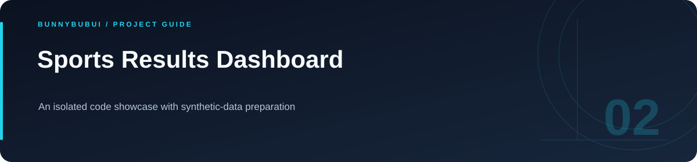

<p align="center">
  
</p>

<h1 align="center">Sports Results Dashboard</h1>

<p align="center">An isolated code showcase with synthetic-data preparation</p>

<p align="center">
      
</p>

<p align="center"><a href="#overview">ภาพรวม</a> · <a href="#start">เริ่มใช้งาน</a> · <a href="#structure">ไฟล์สำคัญ</a></p>

<a id="overview"></a>

## ภาพรวม

source สาธิตที่แยกจากประวัติและข้อมูลของ workspace เดิม ใช้ schema-only และภาพ placeholder เพื่ออ่านโครงสร้างของระบบได้โดยไม่ต้องใช้ข้อมูลจริง

<a id="start"></a>

## เริ่มต้นใช้งาน

ใช้ Node.js 22+ และ MySQL 8 นำเข้าไฟล์ schema-only ใน `server/sql/` และตั้งค่าจาก `server/configs/*.env.example` ก่อนเริ่ม backend

```sh
cp .env.example .env
npm ci
npm run dev

# Terminal 2, from this project directory
cd server
npm ci
npm start
```

frontend ชี้ `VITE_API_URL` ไป http://localhost:3000 การนำเข้าตารางเพียงอย่างเดียวยังไม่มีข้อมูลสาธิตหรือบัญชีผู้ดูแล ต้องสร้างข้อมูลสมมติสำหรับ flow ที่ต้องการตรวจ

<a id="structure"></a>

## ไฟล์สำคัญ

| ตำแหน่ง | หน้าที่ |
|---|---|
| [src/](src) | source ของแอป |
| [server/](server) | backend และการตั้งค่า |

<a id="configuration"></a>

## ตัวอย่างการตั้งค่า

ตัวอย่างค่าตั้งค่าอยู่ในไฟล์ต่อไปนี้ คัดลอกไปยังชื่อไฟล์ local ที่โปรเจกต์อ่านและกำหนดค่าของเครื่องที่ใช้

| ไฟล์ตัวอย่าง | ตัวแปรสำคัญ |
|---|---|
| [.env.example](.env.example) | `VITE_API_URL` |
| [server/configs/db.env.example](server/configs/db.env.example) | `DB_HOST`, `DB_USER`, `DB_PASSWORD`, `DB_NAME` |
| [server/configs/server.env.example](server/configs/server.env.example) | `SECRET_KEY`, `TOKEN_EXPIRE`, `T`, `ADMIN_TOKEN`, `PUBLIC_API_KEY` |

<a id="scope"></a>

## ขอบเขตการสาธิต

frontend build ผ่านในรอบเตรียมพอร์ต มี bundle-size warnings บางส่วน ใช้ข้อมูลสมมติและภาพ placeholder; flow backend ทั้งระบบยังไม่ได้รับรองจากการทดสอบ deployment

ตั้งค่า token ของ operator ก่อนทดสอบสิทธิ์; ไม่ใช้ค่า authentication ที่ว่าง

<a id="reading"></a>

## อ่านต่อ

- [รายละเอียด implementation](docs/IMPLEMENTATION_GUIDE.md)
- [กลับ README หลัก](../../README.md)


---

<p align="center"><a href="https://github.com/BunnyBubui">BunnyBubui</a> · <a href="https://github.com/BunnyBubui/test">Software Portfolio</a></p>
