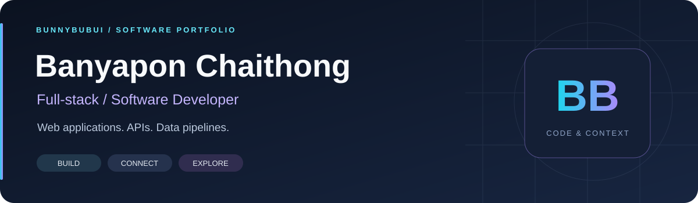
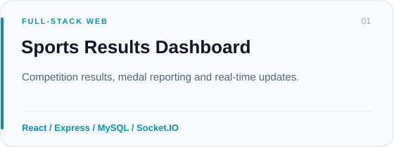
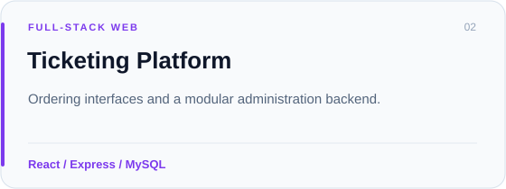
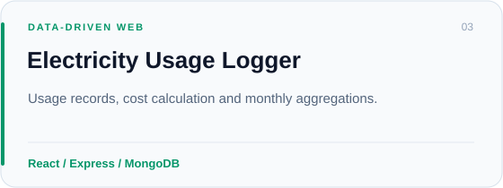
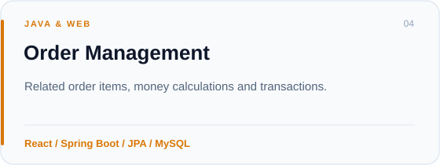
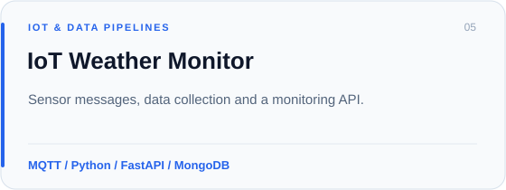
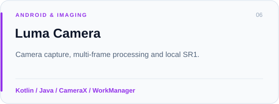

  

  
  

<strong>Full-stack / Software Developer</strong>

## Hi, I'm Banyapon 👋

My portfolio spans **full-stack web applications, REST APIs, IoT data pipelines and Android software**. I enjoy connecting interfaces, backend logic and data into understandable systems.

- **Web & APIs:** React interfaces with Express, FastAPI or Spring Boot backends.
- **Data & integration:** MySQL, MongoDB, MQTT and real-time application flows.
- **Software exploration:** Android camera tools and local image processing.

## Selected projects

<table>
  <tr>
    <td width="50%" align="center">
      <a href="https://github.com/BunnyBubui/test/tree/main/portfolio/sports-results"><picture><source media="(max-width: 600px)" srcset="assets/project-sports-results-mobile.svg" /></picture></a>
      <a href="https://github.com/BunnyBubui/test/tree/main/portfolio/sports-results">Explore source →</a>
    </td>
    <td width="50%" align="center">
      <a href="https://github.com/BunnyBubui/test/tree/main/portfolio/ticketing-platform"><picture><source media="(max-width: 600px)" srcset="assets/project-ticketing-mobile.svg" /></picture></a>
      <a href="https://github.com/BunnyBubui/test/tree/main/portfolio/ticketing-platform">Explore source →</a>
    </td>
  </tr>
  <tr>
    <td width="50%" align="center">
      <a href="https://github.com/BunnyBubui/electricity-logger"><picture><source media="(max-width: 600px)" srcset="assets/project-electricity-mobile.svg" /></picture></a>
      <a href="https://github.com/BunnyBubui/electricity-logger">Explore source →</a>
    </td>
    <td width="50%" align="center">
      <a href="https://github.com/BunnyBubui/prg-01-67100784"><picture><source media="(max-width: 600px)" srcset="assets/project-orders-mobile.svg" /></picture></a>
      <a href="https://github.com/BunnyBubui/prg-01-67100784">Explore source →</a>
    </td>
  </tr>
  <tr>
    <td width="50%" align="center">
      <a href="https://github.com/BunnyBubui/Weather-lab-iot"><picture><source media="(max-width: 600px)" srcset="assets/project-weather-mobile.svg" /></picture></a>
      <a href="https://github.com/BunnyBubui/Weather-lab-iot">Explore source →</a>
    </td>
    <td width="50%" align="center">
      <a href="https://github.com/BunnyBubui/LumaCamera"><picture><source media="(max-width: 600px)" srcset="assets/project-luma-mobile.svg" /></picture></a>
      <a href="https://github.com/BunnyBubui/LumaCamera">Explore source →</a>
    </td>
  </tr>
</table>

Each project README includes its scope, local setup and source references. The sports and ticketing showcases use prepared source snapshots and synthetic-data setup.

## Stack across my projects

| Area | Technologies |
|---|---|
| Frontend | React · TypeScript · JavaScript · HTML · CSS · Vite |
| Backend | Node.js · Express · Python · FastAPI · Java · Spring Boot · JPA |
| Data & integration | MySQL · MongoDB · MQTT · Socket.IO |
| Android & tools | Kotlin · CameraX · WorkManager · Docker · Git · GitHub Actions |

## Explore more

- [Software portfolio and project index](https://github.com/BunnyBubui/test)
- [Resume in English](https://github.com/BunnyBubui/test/blob/main/portfolio/RESUME.en.md) · [เรซูเม่ภาษาไทย](https://github.com/BunnyBubui/test/blob/main/portfolio/RESUME.th.md)
- [FPS Unlocker — Android configuration tool](https://github.com/BunnyBubui/FpsUnlocker)

---

Browse the code. Read the context. Explore the implementation.

