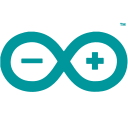

<h1 align="center">Hi 👋, I'm Banyapon Chaithong</h1>

<h3 align="center">Undergraduate student at the School of Informatics, Walailak University Major in Intelligent Information Technology</h3>

  🌱 Focused on <strong>Frontend &amp; Backend Development</strong>, <strong>IoT with ESP32/ESP8266</strong>, and <strong>Android Applications</strong> 
  💻 Learning through practical projects and building useful software solutions

---

<h3 align="center">📫 Connect with me</h3>

  
  
  

Academic email: <a href="mailto:banyapon.ch@mail.wu.ac.th">banyapon.ch@mail.wu.ac.th</a> &nbsp;·&nbsp; <a href="mailto:banyapon.ch@st.wu.ac.th">banyapon.ch@st.wu.ac.th</a>

---

<h3 align="left">📝 About Me</h3>

My name is <strong>Banyapon Chaithong</strong>. I am an undergraduate student at the <strong>School of Informatics</strong>, <strong>Walailak University</strong>, majoring in <strong>Intelligent Information Technology</strong>. My project portfolio focuses on <strong>Frontend &amp; Backend Development, REST APIs, IoT Projects, and Android Applications</strong>. I aim to build practical software by connecting clear interfaces, backend logic and data.

---

<h3 align="left">🛠️ Skills</h3>

- **Frontend Development**: HTML, CSS, JavaScript, TypeScript, React, Vite
- **Backend & APIs**: Node.js, Express, Python, FastAPI, Java, Spring Boot, JPA
- **Databases**: MySQL, MongoDB
- **IoT & Real-time Integration**: ESP32/ESP8266, MQTT, Socket.IO
- **Android Development**: Kotlin, Java, CameraX, WorkManager
- **Development Tools**: Git, Docker, GitHub Actions

---

<h3 align="left">🚀 Projects</h3>

- **Full-stack Web Applications**:
  - [Sports Results Dashboard](https://github.com/BunnyBubui/test/tree/main/portfolio/sports-results) — competition results and real-time updates
  - [Ticketing Platform](https://github.com/BunnyBubui/test/tree/main/portfolio/ticketing-platform) — ordering and administration interfaces
  - [Electricity Usage Logger](https://github.com/BunnyBubui/electricity-logger) — usage records, cost calculation and MongoDB aggregation
- **Java & Backend Development**:
  - [Order Management](https://github.com/BunnyBubui/prg-01-67100784) — Spring Boot/JPA, order items and transactional services
- **IoT & Data Pipelines**:
  - [Weather & Air Quality Monitor](https://github.com/BunnyBubui/Weather-lab-iot) — MQTT collection, MongoDB storage and a FastAPI dashboard
- **Android Applications**:
  - [Luma Camera](https://github.com/BunnyBubui/LumaCamera) — camera capture, multi-frame processing and local image enhancement
  - [FPS Unlocker](https://github.com/BunnyBubui/FpsUnlocker) — game configuration tools and an FPS overlay

---

<h3 align="left">🧰 Languages and Tools</h3>

   &nbsp;
   &nbsp;
   &nbsp;
   &nbsp;
   &nbsp;
   &nbsp;
   &nbsp;
   &nbsp;
   &nbsp;
   &nbsp;
   &nbsp;
   &nbsp;
   &nbsp;
   &nbsp;
   &nbsp;
   &nbsp;
   &nbsp;
   &nbsp;

---

  <a href="https://github.com/BunnyBubui/test">📂 Portfolio</a> &nbsp;•&nbsp;
  <a href="https://github.com/BunnyBubui/test/blob/main/portfolio/RESUME.en.md">📄 Resume (English)</a> &nbsp;•&nbsp;
  <a href="https://github.com/BunnyBubui/test/blob/main/portfolio/RESUME.th.md">📄 เรซูเม่ภาษาไทย</a>

